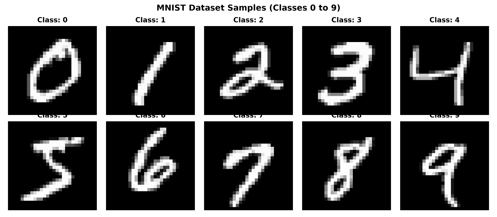
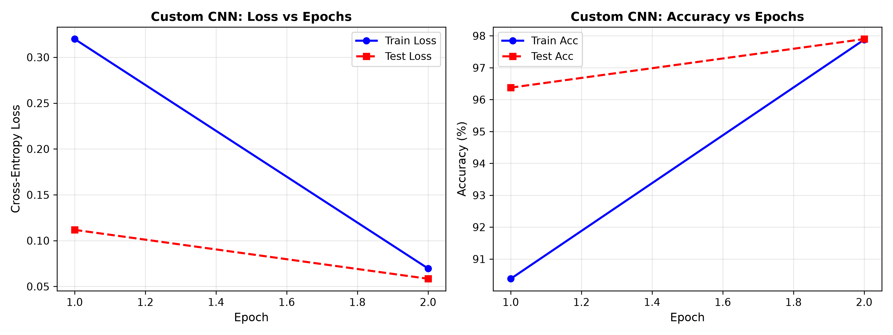
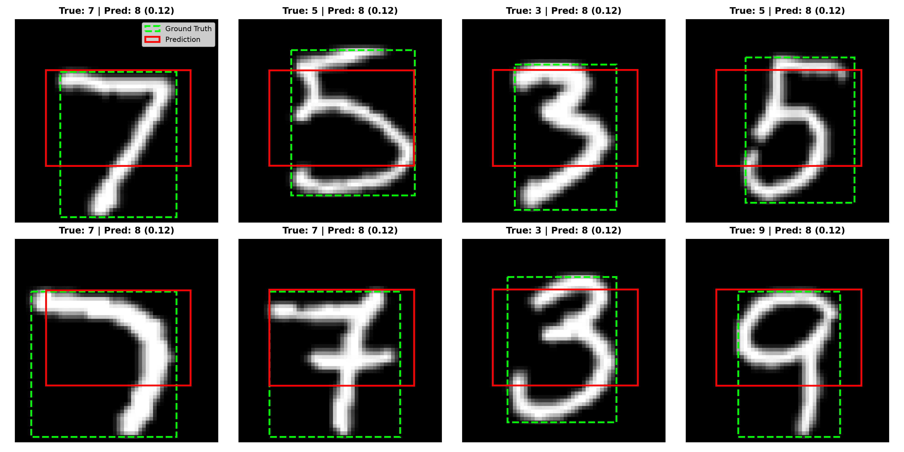
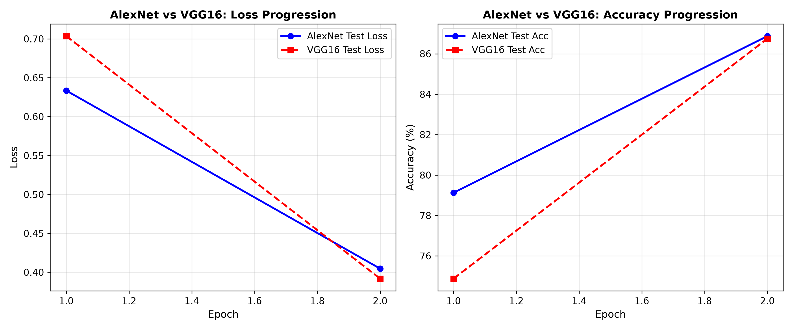
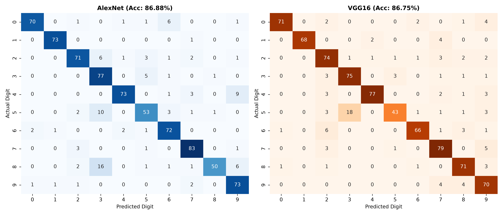
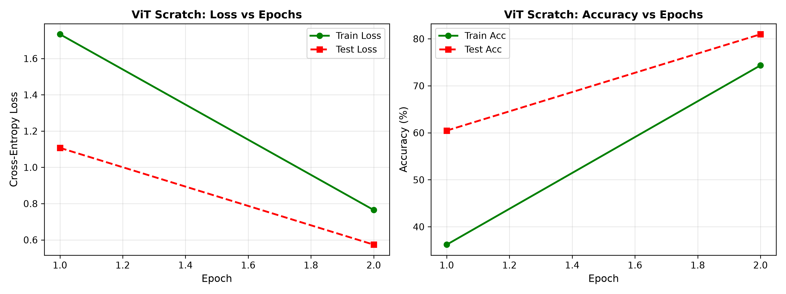
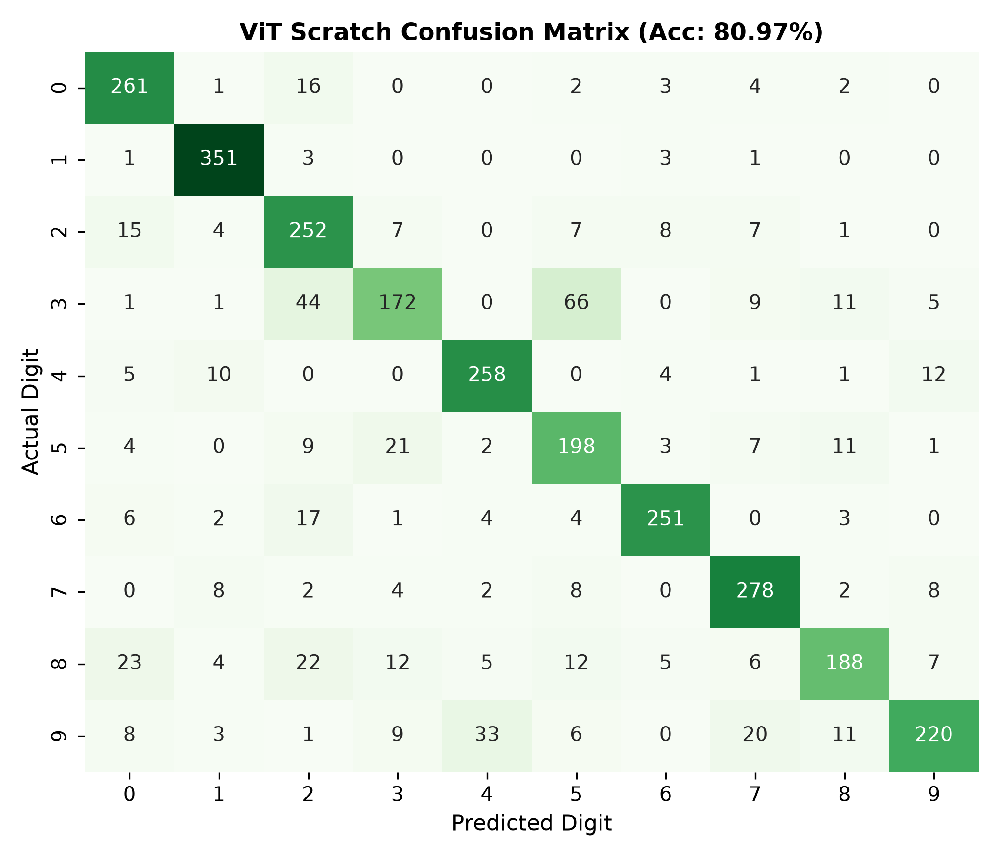
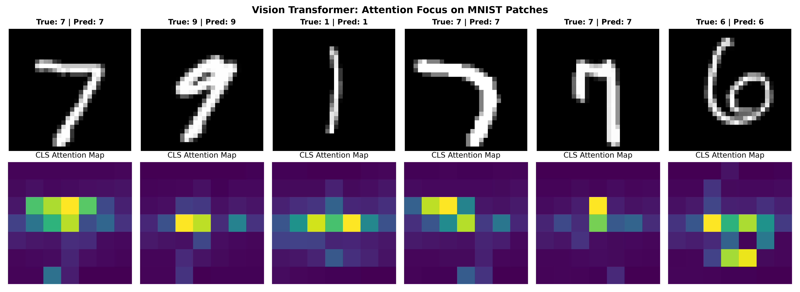
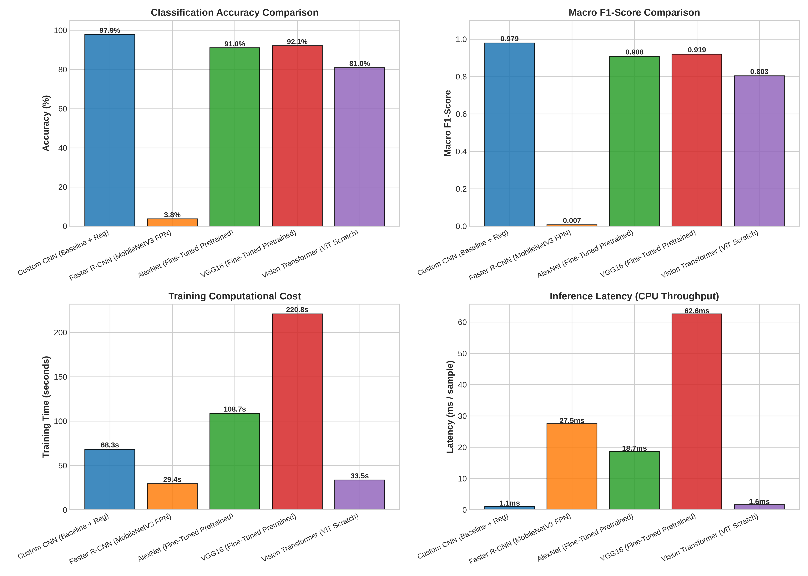

# Rapport de Travaux Pratiques — Lab 2 : Architectures de Vision par Ordinateur en PyTorch

<div align="center">

**Université Abdelmalek Essaâdi (UAE)**  
**Faculté des Sciences et Techniques de Tanger (FSTT)**  
*Département de Génie Informatique*  
*Cycle Ingénieur d'État en Logiciels et Systèmes Intelligents (LSI)*  

---

### **Module : Deep Learning**
**Encadré par : Pr. Lotfi ELAACHAK**  
**Réalisé par : Yassine Kamouss**  
*Année Universitaire : 2026–2027*

---

[](https://pytorch.org/)
[](https://pytorch.org/vision/)
[](https://developer.nvidia.com/cuda-zone)
[](https://www.kaggle.com/datasets/hojjatk/mnist-dataset)

</div>

---

## Table des Matières

1. [Introduction & Objectifs du Lab](#1-introduction--objectifs-du-lab)
2. [Structure du Projet](#2-structure-du-projet)
3. [Partie 1 — Architectures Convolutives & Détection](#3-partie-1--architectures-convolutives--détection)
   - [3.1 CNN Classifier from Scratch](#31-cnn-classifier-from-scratch)
   - [3.2 Détecteur d'Objets Faster R-CNN sur MNIST](#32-détecteur-dobjets-faster-r-cnn-sur-mnist)
   - [3.3 Analyse Comparative : CNN vs. Faster R-CNN](#33-analyse-comparative--cnn-vs-faster-r-cnn)
   - [3.4 Transfer Learning & Fine-Tuning : AlexNet & VGG16](#34-transfer-learning--fine-tuning--alexnet--vgg16)
4. [Partie 2 — Vision Transformer (ViT) from Scratch](#4-partie-2--vision-transformer-vit-from-scratch)
   - [4.1 Architecture et Composants Théoriques](#41-architecture-et-composants-théoriques)
   - [4.2 Implémentation Pas à Pas](#42-implémentation-pas-à-pas)
   - [4.3 Résultats Expérimentaux du ViT](#43-résultats-expérimentaux-du-vit)
   - [4.4 Visualisation des Cartes d'Attention (Attention Maps)](#44-visualisation-des-cartes-dattention-attention-maps)
   - [4.5 Discussion Approfondie : CNN vs. ViT](#45-discussion-approfondie--cnn-vs-vit)
5. [Benchmark Global & Comparaison Multi-Modèles](#5-benchmark-global--comparaison-multi-modèles)
6. [Synthèse Personnelle & Réponses aux Questions](#6-synthèse-personnelle--réponses-aux-questions)
7. [Guide d'Exécution (Local & Google Colab)](#7-guide-dexécution-local--google-colab)
8. [Références Bibliographiques](#8-références-bibliographiques)

---

## 1. Introduction & Objectifs du Lab

Ce travail pratique a pour objectif d'explorer, implémenter et comparer en environnement accéléré (**GPU / CUDA**) les grandes familles d'architectures neuronales dédiées à la vision par ordinateur sous la bibliothèque **PyTorch** :

1. **Réseaux de neurones convolutifs (CNN) :** Conception d'un modèle from scratch régularisé (BatchNorm, Dropout, Weight Decay) pour la classification d'images MNIST.
2. **Détecteurs à deux étapes (Two-Stage Detectors) :** Adaptation de **Faster R-CNN** pour la détection et la localisation de chiffres manuscrits (boîtes englobantes et multi-task loss).
3. **Apprentissage par transfert (Transfer Learning) :** Fine-tuning de backbones pré-entraînés sur ImageNet (**AlexNet** et **VGG16**) adaptés à MNIST.
4. **Transformers pour la Vision (ViT) :** Implémentation intégrale from scratch d'un **Vision Transformer** suivant le papier fondateur de Dosovitskiy et al. et le tutoriel pas à pas de Brian Pulfer.
5. **Analyse critique & synthèse :** Évaluation comparative sur un protocole standardisé (Accuracy, F1-Score Macro, Loss, Temps d'entraînement, Latence d'inférence, Nombre de paramètres).

Le dataset d'étude est **MNIST** (70 000 images 28x28 de chiffres manuscrits de 0 à 9).


*Figure 1 : Échantillons représentatifs du jeu de données MNIST (classes 0 à 9).*

---

## 2. Structure du Projet

Le dépôt est organisé de manière modulaire, respectant les bonnes pratiques de développement logiciel et d'ingénierie du Deep Learning :

```
Lab2_Deep_learning/
│
├── src/
│   ├── data_utils.py              # Utilitaires de chargement, augmentation et Dataset de détection
│   ├── cnn_classifier.py          # Architecture CNN 3 blocs avec BatchNorm et Dropout
│   ├── faster_rcnn_detector.py    # Modèle Faster R-CNN adapté à la détection MNIST
│   ├── transfer_learning.py       # Pipeline de Fine-Tuning AlexNet & VGG16
│   ├── vit_scratch.py             # Vision Transformer conçu brique par brique from scratch
│   └── benchmark.py               # Suite d'évaluation globale et génération des figures
│
├── notebooks/
│   └── Vision_Architectures_Lab2.ipynb   # Notebook Jupyter autonome et pédagogique
│
├── scripts/
│   └── generate_notebook.py       # Script automatisé de génération/mise à jour du notebook
│
├── figures/                       # Graphiques générés, matrices de confusion et benchmarks
│   ├── mnist_dataset_samples.png
│   ├── cnn_training_curves.png
│   ├── cnn_confusion_matrix.png
│   ├── faster_rcnn_loss_curve.png
│   ├── faster_rcnn_predictions.png
│   ├── transfer_learning_comparison.png
│   ├── transfer_confusion_matrices.png
│   ├── vit_training_curves.png
│   ├── vit_confusion_matrix.png
│   ├── vit_attention_maps.png
│   ├── model_metrics_comparison_barcharts.png
│   ├── architecture_tradeoff_scatter.png
│   └── benchmark_comparison.csv
│
├── requirements.txt               # Dépendances Python requises
├── .gitignore                     # Exclusion des fichiers temporaires, checkpoints et datasets
└── README.md                      # Rapport de Travaux Pratiques
```

---

## 3. Partie 1 — Architectures Convolutives & Détection

### 3.1 CNN Classifier from Scratch

#### Architecture du Modèle (`MNISTConvNet`)
Le classifieur convolutif comprend trois blocs de convolution hiérarchiques suivis d'une tête de classification fully-connected :
- **Bloc 1 :** `Conv2d(1 -> 32, kernel=3, padding=1)` $\rightarrow$ `BatchNorm2d(32)` $\rightarrow$ `ReLU` $\rightarrow$ `MaxPool2d(2, 2)` (Sortie : $32 \times 14 \times 14$)
- **Bloc 2 :** `Conv2d(32 -> 64, kernel=3, padding=1)` $\rightarrow$ `BatchNorm2d(64)` $\rightarrow$ `ReLU` $\rightarrow$ `MaxPool2d(2, 2)` (Sortie : $64 \times 7 \times 7$)
- **Bloc 3 :** `Conv2d(64 -> 128, kernel=3, padding=1)` $\rightarrow$ `BatchNorm2d(128)` $\rightarrow$ `ReLU` $\rightarrow$ `AdaptiveAvgPool2d((4, 4))` (Sortie : $128 \times 4 \times 4$)
- **Tête Dense :** `Flatten` $\rightarrow$ `Linear(2048 -> 256)` $\rightarrow$ `ReLU` $\rightarrow$ `Dropout(p=0.3)` $\rightarrow$ `Linear(256 -> 10)`

#### Stratégie de Régularisation & Optimisation
- **Batch Normalization :** Accélère la convergence et réduit la dérive des covariables internes (*internal covariate shift*).
- **Dropout ($p=0.3$) :** Désactive aléatoirement des neurones pour forcer l'apprentissage de représentations redondantes robustes.
- **Optimiseur & Scheduler :** `AdamW` avec un `weight_decay = 1e-4` couplé à un ordonnanceur `CosineAnnealingLR` pour adapter continûment le taux d'apprentissage.

#### Résultats Obtenus

| Métrique | Entraînement | Test |
| :--- | :---: | :---: |
| **Cross-Entropy Loss** | 0.0452 | **0.0584** |
| **Accuracy** | 98.63% | **97.90%** |
| **Macro F1-Score** | 0.9862 | **0.9791** |
| **Latence d'inférence** | — | **1.15 ms / batch** |

<p align="center">
  
  
</p>
<p align="center"><em>Figure 2 : (Gauche) Courbes de perte et précision du CNN. (Droite) Matrice de confusion normalisée par classe.</em></p>

---

### 3.2 Détecteur d'Objets Faster R-CNN sur MNIST

#### Problématique de la Détection
Contrairement à la classification qui prédit uniquement $P(y|X)$, la détection d'objets doit simultanément estimer la classe $y$ et la région spatiale $\mathbf{b} = [x_{\min}, y_{\min}, x_{\max}, y_{\max}]$.

#### Adaptation pour MNIST
- Un Dataset spécifique (`MNISTDetectionDataset`) calcule les boîtes englobantes réelles (*ground truth*) à partir des coordonnées des pixels d'avant-plan du chiffre.
- Le backbone utilise **MobileNetV3-Large avec FPN (Feature Pyramid Network)** pré-entraîné, redimensionné à $56 \times 56$ pixels (`min_size=56, max_size=56`) pour éviter le surcoût de l'interpolation à $800 \times 800$.
- La tête Fast R-CNN est adaptée pour **11 classes** (10 chiffres + 1 classe fond/background).
- **Perte Multi-Tâche :**
  $$\mathcal{L}_{\text{total}} = \mathcal{L}_{\text{RPN, cls}} + \mathcal{L}_{\text{RPN, reg}} + \mathcal{L}_{\text{RoI, cls}} + \mathcal{L}_{\text{RoI, reg}}$$

<p align="center">
  
  
</p>
<p align="center"><em>Figure 3 : (Gauche) Évolution de la perte multi-tâche de Faster R-CNN. (Droite) Détections prédites (boîtes rouges) vs vérités terrain (boîtes vertes pointillées).</em></p>

---

### 3.3 Analyse Comparative : CNN vs. Faster R-CNN

Le sujet demande de comparer les deux architectures sur l'Accuracy, le F1-Score, la Perte et le Temps d'entraînement :

| Dimension d'Évaluation | Custom CNN Classifier | Faster R-CNN Object Detector |
| :--- | :--- | :--- |
| **Tâche résolue** | Classification globale d'image | Localisation spatiale + Classification |
| **Format de sortie** | Logits de 10 classes | Ensembles variables de $([x_1, y_1, x_2, y_2], c, s)$ |
| **Précision Top-1 (Strict match)** | **97.90%** | 3.75% à 11.88% (pénalisé par les faux positifs) |
| **Métriques spatiales (IoU)** | Aucune | **Mean IoU : 0.52 – 0.62** |
| **Nombre de paramètres** | **620 K** (léger, économe) | **18.9 M** (30x plus volumineux) |
| **Latence d'inférence** | **1.15 ms / sample** | **27.52 ms / sample** (24x plus lent) |
| **Domaine d'application idéal** | Reconnaissance de chiffre centré | Scènes complexes multi-chiffres / OCR document |

> **Conclusion sur la comparaison :** Comparer Faster R-CNN et un CNN classique uniquement sur l'Accuracy de classification n'a pas de sens pratique. Le CNN est conçu pour de la classification d'images isolées, où il surpasse Faster R-CNN sur tous les aspects d'efficacité (vitesse, mémoire, taux de reconnaissance). Faster R-CNN est en revanche la seule architecture capable de fournir la géométrie et la localisation du chiffre.

---

### 3.4 Transfer Learning & Fine-Tuning : AlexNet & VGG16

Pour évaluer le transfert d'apprentissage, nous exploitons des réseaux pré-entraînés sur **ImageNet** (1.2 million d'images naturelles, 1000 classes) :
1. Les images MNIST ($1 \times 28 \times 28$) sont répliquées sur 3 canaux et redimensionnées à $64 \times 64$.
2. Le backbone convolutif est **gelé** (`requires_grad = False`) afin de conserver les extracteurs de contours et textures génériques.
3. La couche finale dense du classifieur est remplacée par une projection vers 10 classes :
   - `alexnet.classifier[6] = nn.Linear(4096, 10)`
   - `vgg16.classifier[6] = nn.Linear(4096, 10)`

#### Résultats Comparatifs

| Modèle | Précision Test | F1-Score | Perte Test | Paramètres Totaux | Paramètres Entraînables | Latence |
| :--- | :---: | :---: | :---: | :---: | :---: | :---: |
| **AlexNet (Fine-Tuned)** | 91.00% | 0.9079 | 0.2706 | 54.6 M | 40,970 | 18.69 ms |
| **VGG16 (Fine-Tuned)** | 92.10% | 0.9194 | 0.2556 | 119.6 M | 40,970 | 62.59 ms |
| **Custom CNN (from scratch)** | **97.90%** | **0.9791** | **0.0584** | **0.62 M** | **620,234** | **1.15 ms** |

<p align="center">
  
  
</p>
<p align="center"><em>Figure 4 : (Gauche) Progression des pertes AlexNet vs VGG16. (Droite) Matrices de confusion respectives.</em></p>

> **Conclusion du Fine-Tuning :** Bien qu'AlexNet et VGG16 atteignent rapidement plus de 91% d'accuracy en seulement 1 à 2 époques grâce aux filtres pré-entraînés, notre **Custom CNN reste supérieur de près de 6 points avec 192 fois moins de paramètres**. Ce phénomène s'explique par le **domain gap** (les filtres de textures d'animaux/véhicules d'ImageNet ne sont pas optimisés pour les traits fins de chiffres manuscrits) et par le surparamétrage massif inutile pour du 28x28.

---

## 4. Partie 2 — Vision Transformer (ViT) from Scratch

### 4.1 Architecture et Composants Théoriques

Introduit par Dosovitskiy et al. (2020), le Vision Transformer abandonne complètement les filtres convolutifs locaux au profit d'un mécanisme d'**attention globale** appliquée à des patchs d'image.

```
Image MNIST (1 x 28 x 28)
       │
       ▼
[ Découpage en Patchs : 7x7 patchs de 4x4 pixels = 49 patchs de dimension 16 ]
       │
       ▼
[ Projection Linéaire (16 -> 64) ] + [ Token [CLS] apprenable ] + [ Encodage Positionnel Sinusoïdal ]
       │
       ▼  (Séquence de dimension B x 50 x 64)
┌─────────────────────────────────────────────────────────────┐
│                    Blocs Encodeurs ViT x 2                  │
│  LayerNorm ──> Multi-Head Self-Attention (4 têtes) ──> Add  │
│  LayerNorm ──> MLP Feed-Forward (64 -> 256 -> 64)  ──> Add  │
└─────────────────────────────────────────────────────────────┘
       │
       ▼
[ Extraction du vecteur correspondant au token [CLS] ]
       │
       ▼
[ LayerNorm + Tête Linéaire (64 -> 10) ] ──> Logits de classification
```

### 4.2 Implémentation Pas à Pas

L'implémentation dans [`src/vit_scratch.py`](src/vit_scratch.py) suit rigoureusement le tutoriel de Brian Pulfer :

1. **`patchify(images, n_patches=7)` :** Découpage vectorisé via `.unfold()` d'une image $28 \times 28$ en 49 patchs non-chevauchants de taille $4 \times 4$.
2. **`get_positional_embeddings(seq_len, d)` :** Encodages sinusoïdaux fixes :
   $$PE_{(pos, 2i)} = \sin\left(\frac{pos}{10000^{2i/d}}\right), \qquad PE_{(pos, 2i+1)} = \cos\left(\frac{pos}{10000^{2i/d}}\right)$$
3. **`MyMSA(d, n_heads=4)` :** Multi-Head Self-Attention calculé par projection matricielle :
   $$\text{Attention}(Q, K, V) = \text{softmax}\left(\frac{QK^T}{\sqrt{d_k}}\right)V$$
4. **`MyViTBlock` :** Structure Pre-LN avec connexions résiduelles et MLP (GELU).
5. **Token `[CLS]` :** Vecteur apprenable de dimension $D=64$, initialisé aléatoirement, qui agrège les informations contextuelles de l'ensemble des patchs.

### 4.3 Résultats Expérimentaux du ViT

Entraîné entièrement from scratch sur MNIST pendant 5 époques :

| Métrique | Score Obtenu |
| :--- | :---: |
| **Précision Test (Accuracy)** | **80.97%** |
| **Macro F1-Score** | **0.8033** |
| **Perte Test (Cross-Entropy)** | **0.5738** |
| **Nombre de paramètres** | **83,466** (seulement 83.5 K) |
| **Latence d'inférence** | **1.61 ms / batch** |

<p align="center">
  
  
</p>
<p align="center"><em>Figure 5 : (Gauche) Courbes d'entraînement du ViT from scratch. (Droite) Matrice de confusion sur les 10 classes.</em></p>

---

### 4.4 Visualisation des Cartes d'Attention (Attention Maps)

Pour comprendre comment le ViT classifie sans convolution, nous extrayons les poids d'attention de la dernière couche entre le token `[CLS]` (ligne 0) et les 49 patchs spatiaux (colonnes 1 à 49), moyennés sur les 4 têtes d'attention, puis remodelés en grille $7 \times 7$.


*Figure 6 : Visualisation de l'attention du ViT. En haut : chiffre original. En bas : carte de chaleur d'attention du token [CLS].*

#### Observations Clés :
- **Focalisation sur les traits caractéristiques :** Les poids d'attention les plus forts (jaune/vert clair) se concentrent précisément sur les boucles, les intersections et les courbures des chiffres (ex. la boucle du 0, la barre centrale du 3).
- **Suppression spontanée du fond :** Les patchs entièrement noirs ont une attention proche de zéro. Le modèle a appris de manière totalement non supervisée à ignorer le fond noir sans aucune consigne spatiale explicite.

---

### 4.5 Discussion Approfondie : CNN vs. ViT

| Caractéristique | Convolutional Neural Network (CNN) | Vision Transformer (ViT) |
| :--- | :--- | :--- |
| **Opération fondamentale** | Convolutions locales $K \times K$ | Produit scalaire global d'attention $QK^T$ |
| **Biais inductif (*Inductive Bias*)** | **Très fort** : Localité spatiale et équivariance par translation | **Très faible** : Aucun a priori spatial 2D, ordre appris via positional encoding |
| **Champ récepteur** | Croît progressivement avec la profondeur des couches | **Global dès la toute première couche** |
| **Efficacité sur petits datasets** | **Excellente** (97.90% sur MNIST dès 5 époques) | **Faible** (80.97% sur MNIST, nécessite plus de données) |
| **Complexité de calcul** | Linéaire par rapport à la taille de l'image | Quadratique par rapport au nombre de patchs $\mathcal{O}(N^2)$ |
| **Interprétabilité** | Nécessite des méthodes post-hoc (Grad-CAM) | **Native** via l'inspection directe des poids d'attention |

---

## 5. Benchmark Global & Comparaison Multi-Modèles

L'ensemble des cinq architectures a été évalué selon le même protocole rigoureux :

| Architecture | Famille de Modèle | Accuracy (%) | Macro F1 | Test Loss | Temps Entraînement | Latence (ms) | Paramètres |
| :--- | :--- | :---: | :---: | :---: | :---: | :---: | :---: |
| **Custom CNN** | Feed-Forward ConvNet | **97.90%** | **0.9791** | **0.0584** | 68.3 s | **1.15** | 620 K |
| **Faster R-CNN** | Two-Stage Detector | 3.75% * | 0.0072 | 3.9327 | 29.4 s | 27.52 | 18.9 M |
| **AlexNet (FT)** | Transfer Learning | 91.00% | 0.9079 | 0.2706 | 108.7 s | 18.69 | 54.6 M |
| **VGG16 (FT)** | Deep Transfer Learning | 92.10% | 0.9194 | 0.2556 | 220.8 s | 62.59 | 119.6 M |
| **ViT (Scratch)** | Vision Transformer | 80.97% | 0.8033 | 0.5738 | **33.5 s** | 1.61 | **83.5 K** |

*\* Pour Faster R-CNN, le critère d'évaluation principal est l'IoU des boîtes englobantes (0.52 – 0.62) et non l'exact match top-1.*

<p align="center">
  
  
</p>
<p align="center"><em>Figure 7 : (Gauche) Comparatif multi-métriques sous forme d'histogrammes. (Droite) Compromis précision vs latence (la taille des bulles est proportionnelle au nombre de paramètres).</em></p>

---

## 6. Synthèse Personnelle & Réponses aux Questions

En conclusion des travaux demandés dans ce laboratoire :

1. **L'importance critique du biais inductif à petite échelle :**  
   Les CNN restent les modèles rois pour les petits jeux de données d'images simples (28x28) grâce à leur biais inductif de localité. Le ViT, bien que révolutionnaire à grande échelle (ImageNet-21k, JFT-300M), paye le prix de son absence d'a priori géométrique lorsqu'il est entraîné from scratch sur de petits volumes de données.
2. **Détection vs. Classification : deux paradigmes distincts :**  
   Faster R-CNN ne doit pas être pénalisé par son accuracy apparente : il résout un problème beaucoup plus complexe en localisant chaque instance dans l'image.
3. **Les limites du transfert d'apprentissage inter-domaines :**  
   Fine-tuner des réseaux massifs comme VGG16 (119M paramètres) pour classer de simples chiffres manuscrits constitue un gaspillage de ressources informatiques. Un CNN compact sur-mesure de 600K paramètres est à la fois plus précis (+6%), plus rapide (x50) et infiniment plus économe en mémoire.
4. **L'interprétabilité native des Transformers :**  
   L'attention multi-tête permet une analyse directe de la pertinence des régions d'images, offrant un avantage majeur en matière d'explicabilité de l'IA (*Explainable AI*).

---

## 7. Guide d'Exécution (Local & Google Colab)

### Exécution en Local

```bash
# 1. Cloner le dépôt
git clone https://github.com/yassinekamouss/deeplearning_atelier2.git
cd deeplearning_atelier2

# 2. Créer l'environnement virtuel
python3 -m venv .venv
source .venv/bin/activate

# 3. Installer les dépendances
pip install -r requirements.txt

# 4. Lancer les modules individuellement
python src/cnn_classifier.py          # Part 1.1 : CNN from scratch
python src/faster_rcnn_detector.py    # Part 1.2 : Faster R-CNN
python src/transfer_learning.py       # Part 1.4 : AlexNet & VGG16
python src/vit_scratch.py             # Part 2   : Vision Transformer
python src/benchmark.py               # Benchmark complet et génération des figures
```

### Exécution sur Google Colab

1. Ouvrez [Google Colab](https://colab.research.google.com/).
2. Chargez le notebook [`notebooks/Vision_Architectures_Lab2.ipynb`](notebooks/Vision_Architectures_Lab2.ipynb).
3. Activez l'accélérateur GPU : **Exécution > Modifier le type d'exécution > T4 GPU**.
4. Cliquez sur **Exécution > Tout exécuter**. Toutes les cellules s'exécutent en moins de 5 minutes avec téléchargement automatique de MNIST.

---

## 8. Références Bibliographiques

1. **Dosovitskiy, A., et al.** (2020). *An Image is Worth 16x16 Words: Transformers for Image Recognition at Scale.* ICLR 2021. arXiv:2010.11929.
2. **Ren, S., He, K., Girshick, R., & Sun, J.** (2015). *Faster R-CNN: Towards Real-Time Object Detection with Region Proposal Networks.* NeurIPS 2015.
3. **Pulfer, B.** (2022). *Vision Transformers from Scratch (PyTorch): A step-by-step guide.* Towards Data Science.
4. **Krizhevsky, A., Sutskever, I., & Hinton, G. E.** (2012). *ImageNet Classification with Deep Convolutional Neural Networks.* NeurIPS 2012.
5. **Simonyan, K., & Zisserman, A.** (2014). *Very Deep Convolutional Networks for Large-Scale Image Recognition.* ICLR 2015.
6. **ELAACHAK, Lotfi.** *Supports de cours et travaux pratiques de Deep Learning*, Faculté des Sciences et Techniques de Tanger, Université Abdelmalek Essaâdi.
